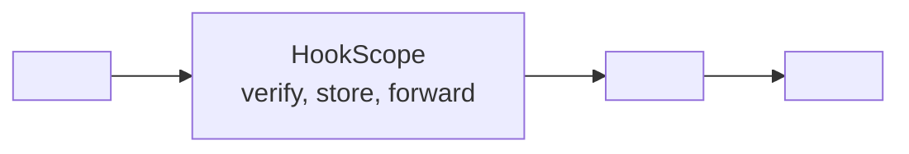
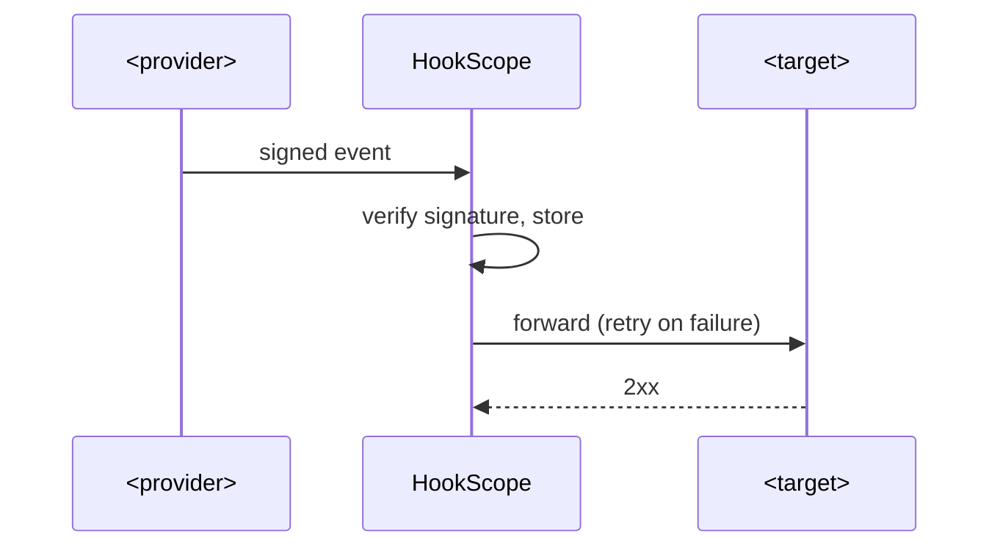

# <recipe-name>

> Copy this folder to `recipes/<recipe-name>/`, replace every `<placeholder>`, and delete the
> guidance lines (the ones starting with `>`). A recipe is finished only when all seven parts
> below are filled in and its tests pass.

One sentence: what the customer wants to happen, and what usually goes wrong.

## 1. Problem and architecture

> The scenario in the customer's words, then the design.

- **Source:** `<provider and event type>`
- **Target:** `<system that receives the result>` (a mock server in tests)
- **What must be true:** `<the guarantees: once per event, in order, within N seconds, ...>`

### Architecture

### Sequence

## 2. Config

> The HookScope rules and the compose file that runs the whole recipe with one command.

- `rules.json`: `<what each rule matches and where it sends it>`
- `docker-compose.yml`: `<services started>`
- Environment variables: `<name: purpose>`

Run it: `make up RECIPE=<recipe-name>`

## 3. Core code

> Small, typed functions. Say where the entry point is and what each module does.

| File | Responsibility |
|---|---|
| `src/<module>.py` | `<one line>` |

## 4. Happy-path tests

> Realistic payloads signed the way the provider signs them (see `common/`).

Run: `make test RECIPE=<recipe-name>`

| Test | Proves |
|---|---|
| `<test name>` | `<behaviour>` |

## 5. Failure-mode tests

> One test per way this integration breaks in production.

| Failure | Test | Expected behaviour |
|---|---|---|
| Target returns 500 | `<test name>` | Retried with backoff, then dead-lettered |
| Target returns 429 | `<test name>` | `<behaviour>` |
| Duplicate delivery | `<test name>` | Handled once |
| Events out of order | `<test name>` | `<behaviour>` |
| Target down, then back | `<test name>` | Replay recovers every event |

## 6. Troubleshooting

> Symptom, likely cause, how to check, how to fix. Use real log lines and metric names.

| Symptom | Likely cause | How to check | Fix |
|---|---|---|---|
| `<what the customer reports>` | `<cause>` | `<command, query or log line>` | `<fix>` |

## 7. Customer pack

### FAQ

- **`<question a customer asks>`** `<answer>`

### Discovery questions

- `<question to ask before building>`

### Go-live checklist

- [ ] Signing secret set and verified with a real test event
- [ ] Endpoint reachable from the provider (no proxy rewriting the URL or body)
- [ ] Retry and dead-letter behaviour agreed with the customer
- [ ] Alerting on failed deliveries
- [ ] `<recipe-specific item>`
