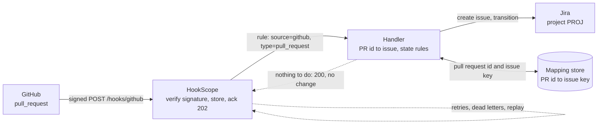
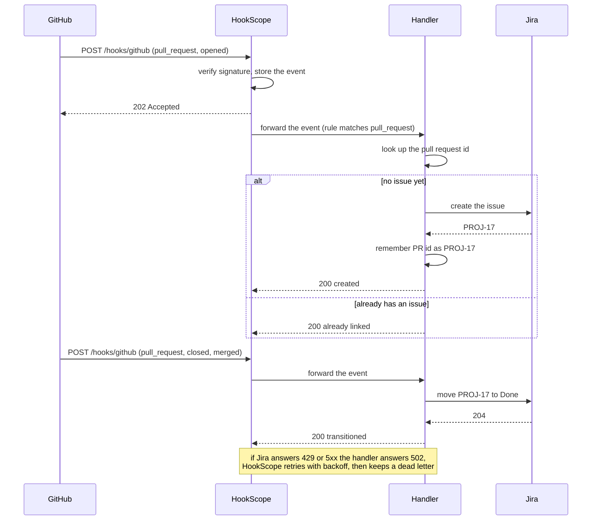

# github-pr-to-jira

Give every GitHub pull request one Jira issue, and keep that issue's status in step with the pull
request, without creating a second issue when GitHub sends the same event twice or when events arrive
in the wrong order.

| Part | Status |
|---|---|
| 1. Problem and architecture | done |
| 2. Config | done (the handler it starts is built in part 3) |
| 3. Core code | done |
| 4. Happy-path tests | done |
| 5. Failure-mode tests | done |
| 6. Troubleshooting | done |
| 7. Customer pack | next |

## 1. Problem and architecture

### The scenario

An engineering manager wants Jira to show the review work that GitHub already knows about. When a
developer opens a pull request, a Jira issue ("Review PR #42: Fix retry backoff") should appear in the
team's project with a link back to the pull request. When the pull request is merged, the issue moves
to **Done**. Nobody should have to copy anything by hand, and nobody should find three issues for one
pull request. Two things decide whether the integration is trusted or switched off:

- **One pull request, one issue.** GitHub delivers a webhook at least once, may deliver it again, and
  gives no ordering guarantee between a `closed` event and the `opened` that came before it. A handler
  that creates an issue for every `opened` it sees will eventually create duplicates.
- **A late event must not undo a later one.** If the "opened" delivery is retried after the pull request
  has already been merged, the issue must stay Done.

### What must be true

| Requirement | Why it matters |
|---|---|
| Only verified GitHub events are acted on | Anyone can POST to a public URL; `X-Hub-Signature-256` is the proof |
| A pull request has at most one issue, whatever arrives, however often | The point of the recipe; identity is the pull request's id, not the delivery |
| Opening a pull request creates the issue; merging moves it to Done | The two transitions the team cares about |
| A `closed` event for a pull request the handler has never seen still ends with a Done issue | Events can arrive out of order, or the first delivery can be lost |
| An old event never moves an issue backwards | A retried `opened` after a merge is news from the past |
| A Jira outage loses nothing | Failed deliveries are retried, then kept as dead letters that can be replayed |
| Events that need no action are not errors | Edits, new commits and labels answer 2xx so HookScope does not retry them |

### Where the filter lives

HookScope forwarding rules match on the **source** and the **event type**. For GitHub the event type is
the `X-GitHub-Event` header, so a rule can pick `pull_request` events but cannot pick "opened" or "closed
and merged", which are values of `action` inside the payload. The rule therefore sends every
`pull_request` event to a small handler, and the handler decides: which actions matter, which issue the
pull request maps to, and what to do. Routing stays in the receiver; the idempotency and state logic
live in code that can be tested.

### Architecture



### One delivery, step by step



### What each pull request event does

| Event (`action`) | The handler | The issue ends up |
|---|---|---|
| `opened` | Creates the issue if the pull request has none | To Do |
| `reopened` | Creates it if missing, otherwise moves it back | To Do |
| `closed` with `merged: true` | Creates it if missing, then moves it | Done |
| `closed` without merging | Records nothing; people decide whether abandoned work is Done | unchanged |
| `edited`, `synchronize`, `labeled`, `review_requested`, others | Nothing to do, answers 200 | unchanged |
| Any event repeated | Finds the existing issue and changes nothing | unchanged |

The issue's summary comes from the pull request (`Review PR #42: Fix retry backoff`), and its text has
the link to the pull request, the repository and the author. These come from the `pull_request` object
in the payload (`number`, `title`, `html_url`, `user.login`) and `repository.full_name`; the sample
event used by the tests is `common/fixtures.py`: `github_pull_request()`.

### Decisions made up front

1. **Identity is the pull request's id**, not the delivery id: a redelivery has the same pull request id
   and so finds the same issue, and a re-opened pull request keeps its one issue.
2. **The handler keeps the pull-request-to-issue mapping itself** (a small database file on a volume),
   because HookScope rules cannot do it and Jira has no notion of "the issue for pull request 1000042".
   The first thing the handler does for a pull request is claim its id, so two deliveries racing each
   other cannot both create an issue. The one gap, a crash after Jira created the issue and before the
   handler recorded its key, is covered in the failure tests and the troubleshooting section.
3. **Move forward only.** Only `reopened` moves an issue back to To Do; a repeated `opened` never does.
4. **Answer 2xx for anything deliberately ignored**, 400 for a payload the handler cannot read, and 502
   only when Jira could not be reached or refused the request, so retries are reserved for real failures.
5. **Jira is a mock in the tests**: `common/mocks.JiraMock` stands in for it, and the recipe says so
   rather than claiming it was exercised against a real Jira site.

## 2. Config

Three files describe the setup; nothing here is code.

| File | What it does |
|---|---|
| [`rules.json`](rules.json) | HookScope's forwarding rule: events from `github` of type `pull_request` go to the handler, with up to 5 attempts and exponential backoff from 2 s to 60 s |
| [`docker-compose.yml`](docker-compose.yml) | Adds the handler (with a volume for its pull-request-to-issue mapping) and a mock Jira to HookScope, and makes HookScope wait for the handler to be healthy |
| [`recipe.env`](recipe.env) | The handler's settings: the Jira project, the issue type, the workflow transition ids and where the mapping is kept |

### The rule

```json
{
  "name": "pull-request",
  "source": "github",
  "event_types": ["pull_request"],
  "target_url": "http://handler:8080/github/pull-request",
  "retry": {"attempts": 5, "backoff_seconds": 2, "max_backoff_seconds": 60}
}
```

- `source` and `event_types` keep every other provider, and every other GitHub event (`push`, `issues`,
  `check_run`, ...), away from the handler. For GitHub the event type is the `X-GitHub-Event` header, so
  `pull_request` is matched there; the `action` inside the payload is the handler's business (part 1).
- The retry policy is what turns a Jira outage into a delay instead of a loss: HookScope waits 2, 4, 8
  and 16 seconds between attempts (longer if the target sends `Retry-After`), then keeps the delivery as
  a dead letter that can be re-sent from the dashboard.
- Only events whose signature verified are forwarded; a forged request is stored and never reaches the handler.

### Settings

| Setting | Where | Meaning |
|---|---|---|
| `HOOKSCOPE_SECRET_GITHUB` | `.env`, written by `make env` | The webhook secret HookScope verifies `X-Hub-Signature-256` with. The demo value comes from `common/fixtures.py`; in production it is the secret you typed into the GitHub webhook settings |
| `JIRA_BASE_URL` | `docker-compose.yml` | Where the handler calls Jira. It points at the mock; for Jira Cloud it is your site's URL |
| `JIRA_EMAIL`, `JIRA_API_TOKEN` | `docker-compose.yml` | The account the handler acts as. The mock ignores them and the values here are placeholders; real ones belong in your secret store, not in git |
| `JIRA_PROJECT` | `recipe.env` | The project key the issues are created in (`PROJ` here) |
| `JIRA_ISSUE_TYPE` | `recipe.env` | The issue type to create (`Task`) |
| `JIRA_TRANSITION_TODO`, `JIRA_TRANSITION_DONE` | `recipe.env` | Workflow transition ids. They differ per Jira project, so look yours up with `GET /rest/api/3/issue/<KEY>/transitions`; `11` and `31` are the ids of the repository's mock |
| `PR_DB` | `recipe.env` | The file holding the pull-request-to-issue mapping, on the `handler-data` volume so a restart keeps it |

The mapping must survive a restart: if it were lost, a redelivery of an old `opened` event would create a
second issue for a pull request that already has one. That is why it lives on a volume, not in memory.

### Run it

```bash
make env                                              # write .env with the demo secrets
make up RECIPE=github-pr-to-jira                      # HookScope, the handler and a mock Jira
python -m common.send github_pull_request action=opened number=42
curl localhost:9001/rest/api/3/issue/PROJ-1           # what "Jira" now holds
python -m common.send github_pull_request action=closed number=42 merged=true
make down RECIPE=github-pr-to-jira
```

`common.send` signs a realistic `pull_request` event the way GitHub does and posts it to HookScope, so the
whole path runs: verification, the rule, the handler, Jira. `make up` builds the handler from `handler/` (part 3).

Compose resolves every relative path against the repository root (the first `-f` file), so the paths in
this recipe's compose file start with `./recipes/github-pr-to-jira/`.

## 3. Core code

The handler is one standard-library file, [`handler/app.py`](handler/app.py), with a short
[`Dockerfile`](handler/Dockerfile). It listens on port 8080: `POST /github/pull-request` for HookScope and
`GET /healthz` for the compose health check. The decisions live in small pieces, separate from HTTP:

| Piece | Job |
|---|---|
| `Settings.from_env` | Reads and checks every setting at once; a missing or malformed one stops the container with one line naming all of them |
| `PullRequests` | The mapping on the volume: pull request id to issue key and last state. `claim` decides who creates the issue |
| `Jira` | The two calls the recipe needs, creating an issue and moving it, signed in with the configured account |
| `parse_event`, `wanted_state` | Read the webhook, and say which state the issue should end in (or that the event needs no action) |
| `Handler.handle` | One event in, `(status, body)` out |

What `handle` answers, and why:

| Situation | Answer | Reason |
|---|---|---|
| New pull request, `opened` (or `reopened`, or a merge) | `200 created` | The issue was created (and moved to Done for a merge) |
| The pull request already has an issue and nothing needs changing | `200 already_linked` | A repeat is not news |
| Merge of a pull request whose issue is still To Do; reopening a Done one | `200 moved` | The only two moves the handler makes |
| `edited`, `synchronize`, a label, a review request, closing without merging | `200 skipped` | A deliberate non-event is not a failure, so HookScope must not retry it |
| Body is not a pull request event | `400 unreadable` | The same bytes will never work, so a retry would only repeat the failure |
| Jira unreachable, refused the request, or answered 429 or 5xx | `502 jira_failed` | A retry can fix it; HookScope backs off, then keeps a dead letter |
| Another delivery for the same pull request is creating the issue right now | `503 busy` | Ask HookScope to come back in a moment |

How one issue per pull request is kept true:

- **Claim first, then create.** Before calling Jira the handler claims the pull request id in the database
  inside one transaction. Of several simultaneous deliveries exactly one is told `claimed`; the rest get
  `503 busy` and retry after the issue is recorded, so they find it.
- **Release on failure.** If Jira fails, the claim is given back, so the retry can create the issue; it
  does not wait for a timeout.
- **A claim nobody finished is taken over** after 60 seconds (`CLAIM_SECONDS`), so a crash between asking
  Jira and recording the key does not block a pull request forever. This is the one gap: if Jira had
  already created the issue before the crash, the takeover creates a second one. Every issue carries the
  label `github-pr-<id>`, so a search finds duplicates and the troubleshooting section tells you how.
- **Forward only.** The handler records the state it last set. A repeated or late `opened` finds the issue
  and changes nothing, so it can never undo a merge; only `reopened` moves a Done issue back to To Do.
- **Ordering.** A merge for a pull request the handler has never seen creates the issue first and then
  moves it, so a lost or late `opened` costs nothing.

The decisions are covered by `tests/test_pr_handler.py`, which runs the handler against the repository's Jira
mock: creation and the issue's text, repeats, a restart, eight simultaneous deliveries, moves, every
ignored action, unreadable bodies, Jira failing at each step, the claim rules and the settings. Part 4
adds the full path through HookScope.

## 4. Happy-path tests

[`tests/test_pr_happy_path.py`](tests/test_pr_happy_path.py) sends signed `pull_request` events (built by
`common/fixtures.py`, signed exactly as GitHub signs them) to a real HookScope app running in-process.
HookScope verifies the signature, stores the event, and forwards it by the recipe's own `rules.json` to the
handler, which runs as a real HTTP server on a free port, with the repository's mock Jira behind it. The
only thing changed is the host name in the rule's target URL (`handler:8080` becomes the local port).

| Test | What it proves |
|---|---|
| An opened pull request creates an issue | Verification, rule match, forward and issue creation work together: summary `Review PR #42: ...`, status To Do, one forward answered 200 |
| The issue links back to the pull request | The description carries the pull request's URL and author |
| Merging moves the issue to Done | `opened` then `closed` with `merged: true` ends with one issue, Done |
| Each pull request gets its own issue | Two pull requests, two issues, with their own summaries |
| Reopening a merged pull request | The same issue goes back to To Do; there is still only one |
| Closing without merging | HookScope answers 202, Jira is untouched, and the skip is recorded as a delivered 200 so it is not retried |
| Actions that need no change | `edited`, `synchronize`, `labeled` and `review_requested` are acknowledged and cause no Jira request at all |
| Other GitHub events | A `push` is stored but matches no rule, so it is never forwarded |
| The stored event | The pull request stays in HookScope for debugging |

I checked that these tests can fail: with the handler changed so a merge no longer counts as an action,
the Done test goes red.

Run them:

```bash
git clone https://github.com/chinmaya-chhatre/Coding_repo hookscope-src
pip install -r hookscope-src/requirements.txt
PYTHONPATH=hookscope-src make test RECIPE=github-pr-to-jira
```

Without HookScope importable these tests are skipped, not failed, so a plain `make test` stays usable; the
recipe's CI job does the setup above, so they always run there once the recipe leaves `.wip`. Duplicates,
out-of-order events, a Jira outage and replay are the failure modes, and belong to part 5.

## 5. Failure-mode tests

[`tests/test_pr_failures.py`](tests/test_pr_failures.py) uses the same setup as part 4 and scripts what goes
wrong. Jira's failures come from the mock (`fail_next`, `rate_limit_next`); HookScope's retries follow this
recipe's `rules.json` (5 attempts), with the backoff wait skipped so the suite stays fast.

| Failure | What the test shows |
|---|---|
| GitHub redelivers the same event | Both deliveries are stored and forwarded, one issue exists, and Jira was asked once |
| Eight deliveries for one pull request at the same moment | Exactly one issue; the others were told to come back (`503`) or found it |
| The merge arrives before the open | One issue, Done; the late `opened` that follows changes nothing |
| A late `opened` after a merge | The issue stays Done: only `reopened` moves it back |
| Jira answers 500 or 429 once | The handler answers 502, HookScope retries, the retry gets through: forward statuses `[502, 200]`, one issue, no dead letter |
| The move to Done fails once | The issue stays To Do, the retry moves it, and there is still one issue |
| Jira is down for every attempt | Five 502s, no issue, one dead letter that is marked resendable |
| Jira comes back, the dead letter is re-sent | The issue is created once, the dead letter clears, and a second click on re-send creates nothing |
| Jira keeps refusing the request (400) | Five attempts, then a dead letter; nothing is created and nothing is lost |
| Another delivery died mid-creation | Five `503`s and a dead letter, then, once the claim is a minute old, a re-send creates the issue |
| A body the handler cannot read | One attempt (`400`, not retried), no Jira request, visible as a dead letter |
| Actions that need no change | One attempt, answered 200, no Jira request |
| Forged signature, tampered body | `401` with a diagnosis, stored for debugging, never forwarded, nothing in Jira |

I confirmed these tests can fail. With the claim no longer released after a Jira failure, five of them go
red (every retry is told the pull request is busy). With the "only `reopened` moves an issue back" rule
removed, both ordering tests go red.

What this part does **not** cover: Jira creating the issue and the handler crashing before it recorded the key.
That is the one gap in the design (part 3): the stale-claim takeover would then create a second issue, which the
`github-pr-<id>` label finds. Part 6 says how to look for it.

## 6. Troubleshooting

Start with the question "did the event arrive, and what did each step say?" Open the event in the HookScope
dashboard (`http://localhost:8000`) or read the logs with `make logs RECIPE=github-pr-to-jira`. A
rejected event shows a **Why did this fail?** panel with the cause and the fix.

A delivery leaves one line from HookScope when it arrives (`event received`), one from the handler
(`created`, `moved`, `already_linked`, `skipped`, `Jira failed` or `busy`), and one from HookScope when the
forward finishes (`forward attempt ... status_code=...`). Where the trail stops tells you where to look. The
`skipped`, `Jira failed`, `busy` and `invalid configuration` lines below were captured from this recipe's own
setup (the one the tests use); the Jira error texts in the tables are `urllib`'s wording plus the start of
Jira's own explanation.

### No issue appeared

| What you see | Cause | Check and fix |
|---|---|---|
| `PR 1000042 #42 skipped: nothing to do for edited` | The action is not one that changes an issue (`edited`, `synchronize`, labels, reviews) | Working as designed. Only `opened`, `reopened` and a merge act |
| `skipped: nothing to do for closed (not merged)` | The pull request was closed without merging | Working as designed: people decide whether abandoned work is Done. Move the issue by hand |
| `already_linked PROJ-1` | This pull request already has an issue | Open `PROJ-1`. Redeliveries and a late `opened` land here by design |
| `forwarded_to: []` in the `202` answer, and no handler line | No rule matched: the event is not `pull_request`, or the webhook is not subscribed to pull request events | In the GitHub webhook settings tick **Pull requests**; compare the event's type in the dashboard with `event_types` in `rules.json` |
| `verification=invalid reason=signature mismatch`, answer `401` | The webhook secret in GitHub is not the one HookScope has | Read the panel's fix; set `HOOKSCOPE_SECRET_GITHUB` to the exact secret typed into GitHub, and restart HookScope |
| `verification=unsigned reason=missing X-Hub-Signature-256 header` | The GitHub webhook has no secret set, or a proxy removed the header | Set a secret in the GitHub webhook settings; check the proxy passes `X-Hub-Signature-256` through |
| `verification=no_secret` | `HOOKSCOPE_SECRET_GITHUB` is not set | Run `make env`, or set the variable, and restart HookScope |
| The dashboard shows a dead letter with `HTTP 400` and the handler logged `unreadable event, answered 400` | The body was not a pull request event (a different webhook content type, or a test ping posted to this rule) | In GitHub choose the content type `application/json`; a `400` is never retried, so it is listed as a dead letter for you to look at |

A rejected or unmatched event is never forwarded, so the handler line is missing by design in those rows.

### Jira is failing

```text
pr-handler WARNING PR 1000044: Jira failed: HTTP Error 503: Service Unavailable
pr-handler WARNING PR 1000045: Jira failed: HTTP Error 400: Bad Request {"error": "injected 400"}
pr-handler WARNING PR 1000046: Jira failed: <urlopen error [Errno 111] Connection refused>
hookscope WARNING forward attempt event_id=3 rule=pull-request attempt=1 status_code=502 elapsed_ms=5 error=None
```

The handler answers `502` and HookScope retries with backoff, five attempts in all. After that the delivery is a
**dead letter**: the dashboard lists it with a **Re-send** button, and so does `GET /api/dead-letters`. The
error text ends with the start of Jira's own explanation, which usually names the field or id it did not accept.

| Cause (usually) | Fix |
|---|---|
| `503`, `429` or `Connection refused`: Jira is down or rate limiting | Wait, then re-send the dead letters. Nothing was lost, and a re-sent pull request gets one issue |
| `401`: the email or API token is wrong or expired | Fix `JIRA_EMAIL` and `JIRA_API_TOKEN`, restart the handler, re-send |
| `403`: the account may not create issues or move them in this project | Give the account the project permission, then re-send |
| `404`: the Jira site URL or project key is wrong | Check `JIRA_BASE_URL` and `JIRA_PROJECT` |
| `400` with a message about the issue type, a field or a transition | `JIRA_ISSUE_TYPE` does not exist in the project, or the project requires a field the handler does not send, or `JIRA_TRANSITION_DONE` is not a transition available from the issue's current status. List the valid transitions with `GET /rest/api/3/issue/<KEY>/transitions` and fix `recipe.env` |
| `status_code=None error=...` on the HookScope line | HookScope cannot reach the handler at all. Check `docker compose ps`: the handler must be healthy (port 8080, `/healthz`) |

### Two issues for one pull request, or none moved

- **A pull request has two issues.** The one known gap: Jira created the issue, the handler died before it
  recorded the key, and a minute later the stale claim was taken over (part 3). Find the pair with the label
  every issue carries: in Jira search `labels = "github-pr-1000042"` (the number is the pull request's id, in
  the event body as `pull_request.id`; `curl localhost:8000/api/events/<id>` shows it). Close the extra one by
  hand; the handler's mapping already points at the one it recorded.
- **The issue stayed To Do after a merge.** Look for the `moved` line for that pull request. No line: the merge
  event never arrived or did not match (see the first table). `Jira failed` lines: see above, then re-send.
  A `moved` line but the issue is back in To Do: a person moved it, or the pull request was reopened.
- **The issue was Done and a repeated `opened` did not reopen it.** Right: only a `reopened` event moves an
  issue back.
- **What does the handler think?** The mapping is a small database on the `handler-data` volume. Read it with
  `docker compose -f docker-compose.base.yml -f recipes/github-pr-to-jira/docker-compose.yml exec handler python -c "import sqlite3; print(sqlite3.connect('/data/pr-issues.db').execute('select pr_id, issue_key, state from prs').fetchall())"`
  which prints rows like `[(1000042, 'PROJ-1', 'To Do')]` (the query is checked here; the `docker compose`
  wrapper around it was not run in this environment).
- **`busy` for a long time.** `PR 1000047: another delivery is creating the issue; ask for a retry` means a
  claim exists with no issue recorded. Normally it clears in a second. If the same pull request stays busy for
  more than a minute, the delivery that held the claim died; the next retry or re-send after a minute takes it
  over.

### The handler will not start

The container prints one line and exits with status 1, naming every setting that is wrong at once:

```text
invalid configuration: JIRA_BASE_URL is not set; JIRA_EMAIL is not set; JIRA_API_TOKEN is not set; ...
invalid configuration: JIRA_EMAIL is not set; ...; JIRA_BASE_URL must be an http(s) URL, got 'ftp://x'; JIRA_TRANSITION_DONE must be a whole number, got 'done'
```

Fix them in `recipe.env` (or the compose file for the Jira URL and credentials). HookScope waits for the
handler's health check, so a handler that cannot start also keeps `make up` from finishing:
`docker compose logs handler` shows the line.

### Known limits

- **Losing the volume loses the mapping.** A redelivered old `opened` event would then create a second issue
  for a pull request that already has one. Back up `handler-data`, or accept a one-off clean-up by label.
- **One crash window**, described under "Two issues for one pull request" above.
- **Closing without merging changes nothing**, by decision. If the customer wants abandoned pull requests moved
  to a "Won't do" status, that is a small change in `wanted_state` and the transitions.

## 7. Customer pack

_To do: FAQ, discovery questions and a go-live checklist._
