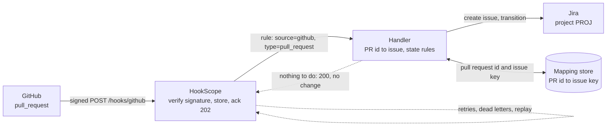
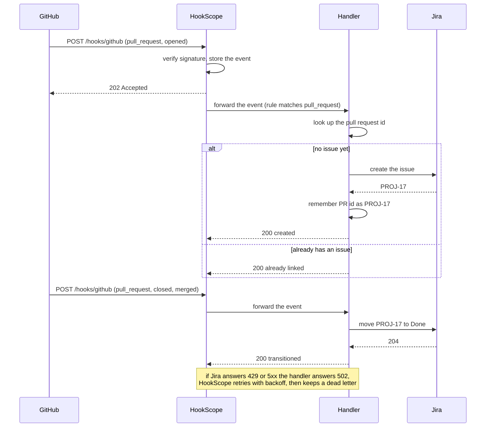

# github-pr-to-jira

Give every GitHub pull request one Jira issue, and keep that issue's status in step with the pull
request, without creating a second issue when GitHub sends the same event twice or when events arrive
in the wrong order.

| Part | Status |
|---|---|
| 1. Problem and architecture | done |
| 2. Config | next |
| 3. Core code | to do |
| 4. Happy-path tests | to do |
| 5. Failure-mode tests | to do |
| 6. Troubleshooting | to do |
| 7. Customer pack | to do |

## 1. Problem and architecture

### The scenario

An engineering manager wants Jira to show the review work that GitHub already knows about. When a
developer opens a pull request, a Jira issue ("Review PR #42: Fix retry backoff") should appear in the
team's project with a link back to the pull request. When the pull request is merged, the issue moves
to **Done**. Nobody should have to copy anything by hand, and nobody should find three issues for one
pull request. Two things decide whether the integration is trusted or switched off:

- **One pull request, one issue.** GitHub delivers a webhook at least once, may deliver it again, and
  gives no ordering guarantee between a `closed` event and the `opened` that came before it. A handler
  that creates an issue for every `opened` it sees will eventually create duplicates.
- **A late event must not undo a later one.** If the "opened" delivery is retried after the pull request
  has already been merged, the issue must stay Done.

### What must be true

| Requirement | Why it matters |
|---|---|
| Only verified GitHub events are acted on | Anyone can POST to a public URL; `X-Hub-Signature-256` is the proof |
| A pull request has at most one issue, whatever arrives, however often | The point of the recipe; identity is the pull request's id, not the delivery |
| Opening a pull request creates the issue; merging moves it to Done | The two transitions the team cares about |
| A `closed` event for a pull request the handler has never seen still ends with a Done issue | Events can arrive out of order, or the first delivery can be lost |
| An old event never moves an issue backwards | A retried `opened` after a merge is news from the past |
| A Jira outage loses nothing | Failed deliveries are retried, then kept as dead letters that can be replayed |
| Events that need no action are not errors | Edits, new commits and labels answer 2xx so HookScope does not retry them |

### Where the filter lives

HookScope forwarding rules match on the **source** and the **event type**. For GitHub the event type is
the `X-GitHub-Event` header, so a rule can pick `pull_request` events but cannot pick "opened" or "closed
and merged", which are values of `action` inside the payload. The rule therefore sends every
`pull_request` event to a small handler, and the handler decides: which actions matter, which issue the
pull request maps to, and what to do. Routing stays in the receiver; the idempotency and state logic
live in code that can be tested.

### Architecture

### One delivery, step by step

### What each pull request event does

| Event (`action`) | The handler | The issue ends up |
|---|---|---|
| `opened` | Creates the issue if the pull request has none | To Do |
| `reopened` | Creates it if missing, otherwise moves it back | To Do |
| `closed` with `merged: true` | Creates it if missing, then moves it | Done |
| `closed` without merging | Records nothing; people decide whether abandoned work is Done | unchanged |
| `edited`, `synchronize`, `labeled`, `review_requested`, others | Nothing to do, answers 200 | unchanged |
| Any event repeated | Finds the existing issue and changes nothing | unchanged |

The issue's summary comes from the pull request (`Review PR #42: Fix retry backoff`), and its text has
the link to the pull request, the repository and the author. These come from the `pull_request` object
in the payload (`number`, `title`, `html_url`, `user.login`) and `repository.full_name`; the sample
event used by the tests is `common/fixtures.py`: `github_pull_request()`.

### Decisions made up front

1. **Identity is the pull request's id**, not the delivery id: a redelivery has the same pull request id
   and so finds the same issue, and a re-opened pull request keeps its one issue.
2. **The handler keeps the pull-request-to-issue mapping itself** (a small database file on a volume),
   because HookScope rules cannot do it and Jira has no notion of "the issue for pull request 1000042".
   The first thing the handler does for a pull request is claim its id, so two deliveries racing each
   other cannot both create an issue. The one gap, a crash after Jira created the issue and before the
   handler recorded its key, is covered in the failure tests and the troubleshooting section.
3. **Move forward only.** Only `reopened` moves an issue back to To Do; a repeated `opened` never does.
4. **Answer 2xx for anything deliberately ignored**, 400 for a payload the handler cannot read, and 502
   only when Jira could not be reached or refused the request, so retries are reserved for real failures.
5. **Jira is a mock in the tests**: `common/mocks.JiraMock` stands in for it, and the recipe says so
   rather than claiming it was exercised against a real Jira site.

## 2. Config

_To do: rules, compose file and settings._

## 3. Core code

_To do: the handler, in small typed functions._

## 4. Happy-path tests

_To do: signed `pull_request` fixtures through HookScope to the handler and Jira._

## 5. Failure-mode tests

_To do: duplicates, out-of-order events, Jira 429 and 500, crash between create and record, replay after
an outage._

## 6. Troubleshooting

_To do: symptom, cause, how to check and fix, with real log lines._

## 7. Customer pack

_To do: FAQ, discovery questions and a go-live checklist._
