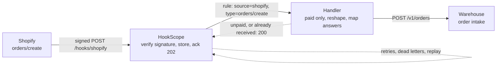
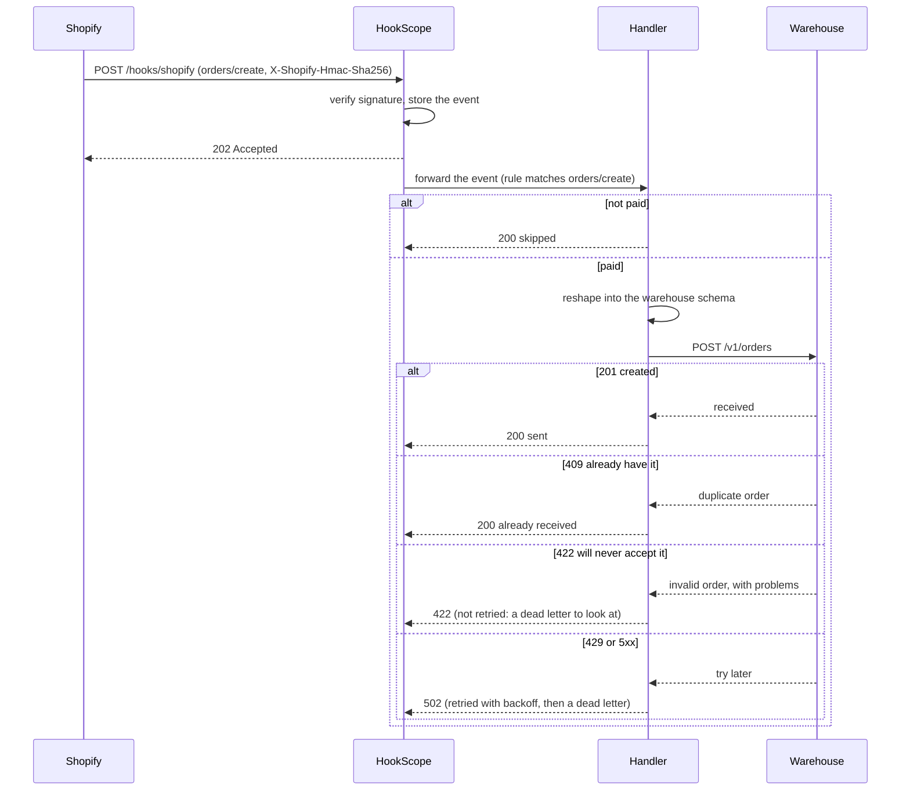

# shopify-order-to-warehouse

Send every paid Shopify order to the warehouse in the shape the warehouse wants, once, and make a warehouse
outage a delay instead of a pile of lost orders.

| Part | Status |
|---|---|
| 1. Problem and architecture | done |
| 2. Config | next |
| 3. Core code | to do |
| 4. Happy-path tests | to do |
| 5. Failure-mode tests | to do |
| 6. Troubleshooting | to do |
| 7. Customer pack | to do |

## 1. Problem and architecture

### The scenario

A small online shop sells through Shopify and ships from a third-party warehouse. The warehouse has its
own order intake API and a strict schema: an order id, lines made of a SKU and a positive whole quantity,
and a shipping address in its own field names. Someone currently copies orders across by hand each
morning. The shop wants every **paid** order to reach the warehouse within seconds of checkout, and it
wants three things to stay true when things go wrong:

- **No order is lost when the warehouse is down.** Maintenance windows and outages happen; the orders
  placed during one must arrive afterwards.
- **No order is shipped twice.** Shopify may deliver a webhook more than once, HookScope retries a failed
  delivery, and a person may re-send one by hand. The warehouse must still see each order once.
- **An order that cannot be shipped is visible, not silently retried forever.** A line item without a SKU
  (a custom charge, a gift card) is a data problem a retry cannot fix; someone has to look at it.

### What must be true

| Requirement | Why it matters |
|---|---|
| Only verified Shopify events are acted on | Anyone can POST to a public URL; `X-Shopify-Hmac-Sha256` is the proof |
| Only paid orders go to the warehouse | `orders/create` also fires for unpaid and pay-later orders |
| The warehouse receives its own schema, not Shopify's | It rejects what it does not recognise, and it should not get data it does not need (the customer's email, prices) |
| The order id is kept exact | Shopify ids are 64-bit integers; as JSON numbers they lose digits in many languages, so the id travels as a string |
| A repeat of an order is a success, not an error | The warehouse answers `409` for an order it already has; that is the proof it arrived |
| A warehouse outage loses nothing | Failed deliveries are retried with backoff, then kept as dead letters that can be replayed |
| An order the warehouse will never accept is visible | A `422` is permanent: HookScope does not retry it and lists it as a dead letter with the reason |
| Events that need no action are not errors | Unpaid orders answer 2xx, so HookScope does not retry something deliberately skipped |

### Where the filter and the reshaping live

HookScope forwarding rules match on the **source** and the **event type**. For Shopify the event type is
the `X-Shopify-Topic` header, so a rule can pick `orders/create` but cannot pick "paid only", which is a
value inside the payload, and it cannot reshape a body. Both therefore live in a small handler between
HookScope and the warehouse, which is the code this recipe builds (part 3). Routing stays in the receiver;
the business rules and the mapping live in code that can be tested.

### Architecture

### One delivery, step by step

### The mapping

| Warehouse field | From the Shopify order | Notes |
|---|---|---|
| `order_id` | `id` | As a string, so no digit is lost |
| `reference` | `name` (`#1001`) | What the shop's staff recognise |
| `lines[].sku` | `line_items[].sku` | Required; a line without one cannot be shipped |
| `lines[].qty` | `line_items[].quantity` | A positive whole number |
| `lines[].title` | `line_items[].title` | For the packing slip |
| `ship_to.name`, `address1`, `city` | `shipping_address` | Same names |
| `ship_to.region` | `shipping_address.province_code` | |
| `ship_to.postal_code` | `shipping_address.zip` | |
| `ship_to.country` | `shipping_address.country_code` | |

Not sent: the customer's email and phone, prices and totals. The warehouse does not need them to ship a
parcel. The sample event used by the tests is built by `common/fixtures.py`: `shopify_order_created()`.

### Decisions made up front

1. **The warehouse's own duplicate answer is the deduplication.** Instead of the handler keeping a table of
   orders it has seen, a `409` from the warehouse means "already have it" and counts as success. That is
   safe across restarts, retries and manual re-sends, and it needs no state in the handler. The price is
   that the warehouse must really answer `409` for a repeated order id, which is a question for the
   customer's warehouse (part 7).
2. **Only paid orders go.** Others are acknowledged and skipped, never an error. The alternative, listening
   to `orders/paid` instead, suits pay-later shops and is a one-line change in `rules.json`.
3. **Permanent and temporary failures are told apart.** `422` (the warehouse will never accept this order)
   passes through as `422`, which HookScope does not retry, so the order shows up in the dead-letter list
   with its reason. `429` and `5xx` become `502`, which HookScope retries with backoff.
4. **A skipped order is logged with its reason**, so "why did order #1042 not reach the warehouse?" is
   answered by one log line.
5. **The warehouse is a mock in the tests**: `common/mocks.WarehouseMock` stands in for it, including its
   `409` for duplicates and its `422` schema check, and the recipe says so rather than claiming it was
   exercised against a real warehouse.

## 2. Config

_To do: rules, compose file and settings._

## 3. Core code

_To do: the handler, in small typed functions._

## 4. Happy-path tests

_To do: signed `orders/create` fixtures through HookScope to the handler and the warehouse._

## 5. Failure-mode tests

_To do: duplicates, unpaid orders, a line without a SKU, warehouse 429 and 500, an outage and replay._

## 6. Troubleshooting

_To do: symptom, cause, how to check and fix, with real log lines._

## 7. Customer pack

_To do: FAQ, discovery questions and a go-live checklist._
