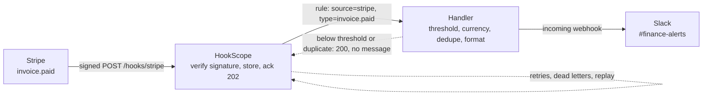
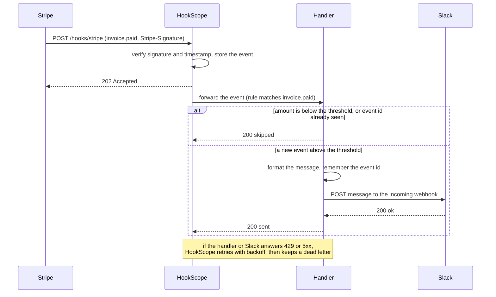

# stripe-invoice-paid-to-slack

Tell the finance team in Slack when a customer pays an invoice above a threshold, in a message a
human can act on, without drowning the channel in small invoices and without announcing the same
payment twice.

| Part | Status |
|---|---|
| 1. Problem and architecture | done |
| 2. Config | done (the handler it starts is built in part 3) |
| 3. Core code | done |
| 4. Happy-path tests | done |
| 5. Failure-mode tests | done |
| 6. Troubleshooting | done |
| 7. Customer pack | done |

## 1. Problem and architecture

### The scenario

A finance team at a SaaS company wants one thing from Stripe: a Slack message in `#finance-alerts`
when a **large** invoice is paid, such as a $5,000 annual plan, so they can reconcile it and thank the
customer. Small invoices (monthly $29 plans) happen hundreds of times a day and must stay out of the
channel. Two details decide whether the alert is trusted or muted within a week:

- **The message has to be readable.** Stripe's payload is a deep JSON document; finance wants the
  invoice number, the customer, the amount in the right currency and a link to open the invoice.
- **It must fire once per payment.** Stripe documents that an endpoint can receive the same event more
  than once, and Slack gets no say in that, so the integration has to deduplicate.

### What must be true

| Requirement | Why it matters |
|---|---|
| Only verified Stripe events are acted on | Anyone can POST to a public URL; the `Stripe-Signature` header is the proof |
| An invoice below the threshold sends nothing | The point of the filter |
| The threshold is in the customer's units, per currency | Stripe amounts are integers in the smallest unit (cents), and some currencies have no minor unit, so `5000` means $50.00 for USD and ¥5,000 for JPY |
| The same event never produces two messages | Stripe may redeliver; HookScope may retry |
| A Slack outage loses nothing | Failed deliveries are retried, then kept as dead letters that can be replayed |
| A skipped invoice is not an error | The handler answers 2xx, so HookScope does not retry something that was deliberately ignored |

### Where the filter lives

HookScope forwarding rules match on the **source** and the **event type** (`invoice.paid`), not on
values inside the payload, so a rule cannot say "only above $5,000". HookScope's built-in
`format: slack` would post every paid invoice. The minimum-amount filter, the currency handling and
the deduplication therefore live in a small handler that sits between HookScope and Slack, and that
handler is the code this recipe builds (part 3). This split is deliberate and worth knowing in a
customer conversation: put routing in the receiver, and business rules in code you can test.

### Architecture



### One delivery, step by step



### The message finance sees

```text
Invoice ACME-0042 paid: 1,250.00 USD
Customer: billing@acme.example
Open invoice: https://invoice.stripe.com/i/acct_test/in_1QxAcmeInvoice
(event evt_1QxAcmePaid, test mode)
```

The invoice number, customer email, amount and link come from the `invoice` object inside the event
(`number`, `customer_email`, `amount_paid`, `currency`, `hosted_invoice_url`). The sample payload used
by the tests is built by `common/fixtures.py`: `stripe_invoice_paid()`.

### Decisions made up front

1. **Deduplicate on the Stripe event id** (`evt_...`), not on the invoice id: a second event about the
   same invoice (a later correction) is news, a redelivery of the first is not.
2. **Compare in major units per currency**, using a small table of zero-decimal currencies, so the
   threshold reads "5,000 USD", not "500000".
3. **Answer 2xx for skips**, 5xx only when Slack could not be reached, so retries are reserved for
   real failures.
4. **Slack is a mock in the tests**: the repository's `common/mocks` stands in for it, and the recipe
   says so rather than claiming it was exercised against a real workspace.

## 2. Config

Three files describe the setup; nothing here is code.

| File | What it does |
|---|---|
| [`rules.json`](rules.json) | HookScope's forwarding rule: events from `stripe` of type `invoice.paid` go to the handler, with up to 5 attempts and exponential backoff from 2 s to 60 s |
| [`docker-compose.yml`](docker-compose.yml) | Adds the handler and a mock Slack to HookScope (from the repository's base compose file) and makes HookScope wait for the handler to be healthy |
| [`recipe.env`](recipe.env) | The handler's settings: the per-currency thresholds and how many event ids to remember |

### The rule

```json
{
  "name": "invoice-paid",
  "source": "stripe",
  "event_types": ["invoice.paid"],
  "target_url": "http://handler:8080/stripe/invoice-paid",
  "retry": {"attempts": 5, "backoff_seconds": 2, "max_backoff_seconds": 60}
}
```

- `source` and `event_types` keep every other provider and every other Stripe event away from the handler.
- The retry policy is what turns a Slack or handler outage into a delay instead of a loss: HookScope waits
  2, 4, 8 and 16 seconds between attempts (longer if the target sends `Retry-After`), then keeps the
  delivery as a dead letter that can be resent from the dashboard.
- Only events whose signature verified are forwarded; a forged request is stored and never reaches the handler.

### Settings

| Setting | Where | Meaning |
|---|---|---|
| `HOOKSCOPE_SECRET_STRIPE` | `.env`, written by `make env` | The signing secret HookScope verifies with. The demo value comes from `common/fixtures.py`; in production it is the endpoint's `whsec_...` from the Stripe dashboard |
| `INVOICE_THRESHOLDS` | `recipe.env` | Minimum amount per currency in major units, e.g. `USD:5000,EUR:4500,JPY:750000`. A currency that is not listed never alerts |
| `SLACK_WEBHOOK_URL` | `docker-compose.yml` | Where the handler posts. It points at the mock Slack; put a real incoming-webhook URL here to try it for real |
| `DEDUPE_MEMORY` | `recipe.env` | How many Stripe event ids to remember when ignoring redeliveries |

### Run it

```bash
make env                                              # write .env with the demo secrets
make up RECIPE=stripe-invoice-paid-to-slack           # HookScope, the handler and a mock Slack
python -m common.send stripe_invoice_paid amount_paid=500000 currency=usd
curl localhost:9000/_mock/messages                    # what "Slack" received
make down RECIPE=stripe-invoice-paid-to-slack
```

`common.send` signs a realistic `invoice.paid` event the way Stripe does and posts it to HookScope, so the
whole path runs: verification, the rule, the handler, Slack. `make up` builds the handler from `handler/` (part 3).

Compose resolves every relative path against the repository root (the first `-f` file), so the paths in
this recipe's compose file start with `./recipes/stripe-invoice-paid-to-slack/`.

## 3. Core code

The handler is one standard-library file, [`handler/app.py`](handler/app.py), with a two-line
[`Dockerfile`](handler/Dockerfile). It listens on port 8080: `POST /stripe/invoice-paid` for HookScope and
`GET /healthz` for the compose health check. The decisions live in small functions, separate from HTTP:

| Function | Job |
|---|---|
| `parse_thresholds` | Reads `INVOICE_THRESHOLDS`; a malformed or empty value stops the container with a clear message instead of silently alerting on nothing |
| `major_units` | Stripe's integer to the currency's major unit: cents (/100) for most, none for zero-decimal currencies such as JPY, thousandths for KWD |
| `is_large` | At or above the threshold for that currency; a currency with no threshold never alerts |
| `SeenEvents` | The last `DEDUPE_MEMORY` event ids; the oldest is forgotten first |
| `format_message` | The four-line text finance reads (shown in part 1) |
| `Handler.handle` | One event in, `(status, body)` out |

What `handle` answers, and why:

| Situation | Answer | Reason |
|---|---|---|
| Large invoice, new event | `200 sent` | Slack accepted the message |
| Below the threshold, unknown currency, wrong event type | `200 skipped` | A deliberate skip is not a failure, so HookScope must not retry it |
| Event id already handled | `200 skipped` (duplicate) | The same payment is announced once |
| Body is not JSON, or lacks the invoice fields | `400 unreadable` | The same bytes will never work, so a retry would only repeat the failure |
| Slack unreachable, or it refused the message | `502 slack_failed` | The one case a retry can fix; HookScope backs off and retries, then keeps a dead letter |

Two details are easy to get wrong. The event id is remembered **after** Slack accepted the message, so a
retry following a Slack failure still sends. And the memory is in-process: it survives HookScope's retries
and Stripe's redeliveries, but not a handler restart, which is acceptable here because a duplicate message
after a restart is an annoyance, not a loss (a shared store such as Redis is the upgrade if it matters).

The decision functions are covered by `tests/test_handler.py`, which runs the handler against the
repository's Slack mock. Part 4 adds the full path through HookScope.

## 4. Happy-path tests

[`tests/test_happy_path.py`](tests/test_happy_path.py) sends signed `invoice.paid` events (built by
`common/fixtures.py`, signed exactly as Stripe signs them) to a real HookScope app running in-process.
HookScope verifies the signature, stores the event, and forwards it by the recipe's own `rules.json` to the
handler, which runs as a real HTTP server on a free port. Slack is the repository's mock. The only thing
changed is the host name in the rule's target URL (`handler:8080` becomes the local port).

| Test | What it proves |
|---|---|
| A large USD invoice reaches Slack | Verification, rule match, forward and message work together; HookScope records one 200 forward |
| The message has everything finance needs | Invoice number, amount, customer, link and event id appear exactly as shown in part 1 |
| Each currency uses its own threshold | EUR, GBP and zero-decimal JPY alert at their own limits |
| A small invoice is acknowledged and silent | HookScope answers 202, nothing reaches Slack, and the skip is recorded as a delivered 200 so it is not retried |
| Distinct invoices each get a message | Two different Stripe events are two messages |
| Other Stripe events never reach the handler | An `invoice.created` is stored but no rule matches, so there is no forward |

Run them:

```bash
git clone https://github.com/chinmaya-chhatre/Coding_repo hookscope-src
pip install -r hookscope-src/requirements.txt
PYTHONPATH=hookscope-src make test RECIPE=stripe-invoice-paid-to-slack
```

Without HookScope importable these tests are skipped, not failed, so a plain `make test` stays usable;
the recipe's CI job does the setup above, so they always run there. Duplicates, Slack outages and replay
are the failure modes, and belong to part 5.

## 5. Failure-mode tests

[`tests/test_failures.py`](tests/test_failures.py) uses the same setup as part 4 and scripts what goes
wrong. Slack's failures come from the mock (`fail_next`, `rate_limit_next`); HookScope's retries follow this
recipe's `rules.json` (5 attempts), with the backoff wait skipped so the suite stays fast.

| Failure | What the test shows |
|---|---|
| Stripe redelivers the same event | Both deliveries are stored and forwarded, Slack gets one message, the handler answers the repeat with a quiet 200 |
| A second event about the same invoice | It is news: two event ids, two messages |
| Slack answers 500 or 429 once | The handler answers 502, HookScope retries, the retry gets through: forward statuses `[502, 200]`, one message, no dead letter |
| A failed attempt must not count as seen | Otherwise the retry would be skipped as a duplicate and the message lost; this test and the two above fail if the handler remembers the id before Slack accepts it |
| Slack is down for every attempt | Five 502s, no message, one dead letter that is marked resendable |
| Slack comes back, the dead letter is re-sent | The message is delivered once, the dead letter clears, and a second click on re-send does not announce it again |
| Below the threshold, an unlisted currency, one yen under | Slack is not called at all and HookScope sees a single successful attempt, so nothing is retried |
| The JPY boundary | 750,000 JPY alerts as `750,000 JPY`: yen have no cents, so the amount is not divided by 100 |
| Forged signature, tampered body | `401`, stored for debugging, never forwarded, nothing in Slack |

I confirmed these tests can fail: with the handler changed to remember the event id before posting to
Slack, five of them go red. What this part does **not** cover: the handler restarting (its duplicate memory
is in-process, see part 3) and Slack being slow rather than failing; both are known limits, and part 6
is where spotting them belongs.

## 6. Troubleshooting

Start with the question "did the event arrive, and what did each step say?" Open the event in the HookScope
dashboard (`http://localhost:8000`) or read the logs with `make logs RECIPE=stripe-invoice-paid-to-slack`.
The `skipped`, `slack unreachable`, `event received` and `invalid configuration` lines below were captured from
running this recipe's own setup (the one the tests use); the Slack and DNS error texts in the tables are
the wording Python's `urllib` produces.

A delivery leaves one line from HookScope when it arrives (`event received`), one from the handler
(`sent`, `skipped` or `slack unreachable`) and one from HookScope when the forward finishes
(`forward attempt ... status_code=...`). Where the trail stops tells you where to look.

### No message in Slack

| What you see | Cause | Check and fix |
|---|---|---|
| Handler log: `skipped evt_small: below threshold (29.00 USD)` | The invoice is under the threshold | Working as designed. To alert on smaller invoices, lower the currency's value in `INVOICE_THRESHOLDS` (`recipe.env`) and restart the handler |
| `skipped evt_chf: no threshold for CHF` | The currency is not in `INVOICE_THRESHOLDS`, and an unlisted currency never alerts | Add `CHF:4000` (an amount in whole francs, not centimes) |
| `skipped evt_big: duplicate` | Stripe or HookScope sent this event id again; the first copy was announced | Nothing to fix. If you replayed an old event on purpose, the handler has seen it: restart it, or send a new event |
| `forwarded_to: []` in the `202` answer, and no handler line | No rule matched: the event is not `invoice.paid`, or the rule's `source` is not `stripe` | Compare the event's type in the dashboard with `event_types` in `rules.json`. In the Stripe dashboard, make sure the endpoint is subscribed to `invoice.paid` |
| `event received ... verification=invalid reason=signature mismatch`, answer `401` | The signing secret HookScope uses is not the endpoint's | Copy the endpoint's `whsec_...` from the Stripe dashboard into `HOOKSCOPE_SECRET_STRIPE` and restart HookScope. Rejected events are kept, so you can see them |
| `verification=invalid reason=timestamp outside tolerance (possible replay)` | The request is older than five minutes, or this machine's clock is wrong | Check the clock (`date -u`). A signed request saved from earlier and posted again by hand will always be too old; to run an old event again use the dashboard's **Re-send**, which forwards the stored event without checking the signature a second time |
| `verification=unsigned reason=missing Stripe-Signature header` | The request did not come from Stripe, or a proxy removed the header | Check that the proxy forwards the `Stripe-Signature` header and the exact body bytes |
| `verification=no_secret reason=no secret configured for 'stripe'` | `HOOKSCOPE_SECRET_STRIPE` is not set | Run `make env`, or set the variable, and restart HookScope |

A rejected or unmatched event is never forwarded, so the handler line is missing by design in those rows.

### Slack is failing

```text
invoice-handler WARNING slack unreachable or refused evt_down: HTTP Error 503: Service Unavailable
hookscope WARNING forward attempt event_id=3 rule=invoice-paid attempt=1 status_code=502 elapsed_ms=5 error=None
... the same pair for attempts 2, 3, 4 and 5 ...
```

The handler answers `502` and HookScope retries with backoff, five attempts in all. After that the delivery is a
**dead letter**: the dashboard lists it with a **Re-send** button, and so does `GET /api/dead-letters`.

| Cause | Fix |
|---|---|
| Slack is down or rate limiting (`HTTP Error 429` or `5xx`) | Wait for Slack, then re-send the dead letters. Nothing was lost, and a re-sent invoice is announced once |
| `HTTP Error 404: Not Found` or `403` | The webhook URL was revoked or mistyped. Create a new incoming webhook, set `SLACK_WEBHOOK_URL`, restart the handler, then re-send. The handler turns every Slack failure into a `502`, so these are retried five times before they become dead letters |
| `slack unreachable ...: <urlopen error [Errno -2] Name or service not known>` | The handler cannot resolve the host: a typo in the URL, or no outbound DNS from the container |
| `status_code=None error=...` on the HookScope line | HookScope cannot reach the handler at all. Check `docker compose ps`: the handler must be healthy (it listens on 8080 and answers `/healthz`) |

### The handler will not start

The container prints one line and exits with status 1. Fix the named setting in `recipe.env` (or the
compose file for `SLACK_WEBHOOK_URL`):

```text
invalid configuration: INVOICE_THRESHOLDS: cannot read 'USD:abc', expected CODE:AMOUNT, e.g. USD:5000
invalid configuration: INVOICE_THRESHOLDS is empty, so no invoice could ever alert
invalid configuration: SLACK_WEBHOOK_URL must be an http(s) URL
invalid configuration: DEDUPE_MEMORY must be a whole number, got 'lots'
```

HookScope waits for the handler's health check, so a handler that cannot start also keeps `make up` from
finishing: `docker compose logs handler` shows the line.

### Known limits

- **A handler restart forgets the event ids it has seen.** A redelivery that arrives after a restart is
  announced again. Rare, and a duplicate message is an annoyance rather than a loss; a shared store such as
  Redis is the fix if it matters to the customer.
- **Slow Slack.** The handler waits up to 10 seconds for Slack; a Slack slower than that counts as a
  failure and is retried, which can produce a second message if Slack did accept the first one. Rare in
  practice because Slack answers in well under a second.
- **Amounts are the invoice's `amount_paid`.** Partial payments and credit notes show the amount actually
  paid on that event, not the invoice total.

## 7. Customer pack

What to hand a customer, and what to ask before building it for them. The answers describe this recipe as
built and tested here; where something is a limit or not built, it says so.

### FAQ

- **Why is the minimum amount not a HookScope rule?** A forwarding rule matches on the provider and the
  event type, not on values inside the payload, so it cannot say "above $5,000". The amount filter lives in
  the small handler, where it is plain code with tests. Routing stays in the receiver; business rules stay
  in code you can read.
- **How do we change a threshold?** Edit `INVOICE_THRESHOLDS` in `recipe.env` and restart the handler. No
  HookScope change. Amounts are in whole currency units (`USD:5000` is $5,000.00; `JPY:750000` is ¥750,000).
- **Will an invoice ever be announced twice?** Not for the same Stripe event: the handler remembers the
  event ids it announced. The memory is in-process, so a handler restart forgets it (see part 6). A second,
  different event about the same invoice is announced, because it is news.
- **What if Slack is down?** Nothing is lost. The handler answers `502`, HookScope retries five times with
  backoff, and anything still failing becomes a dead letter that can be re-sent from the dashboard once
  Slack is back. A re-sent invoice is announced once.
- **Can different currencies or amounts go to different channels?** Not in this recipe: one Slack webhook
  URL means one channel. It is a small change in the handler (a webhook URL per currency or band); the
  structure of part 3 is meant for it.
- **Which events does it handle?** `invoice.paid` only. Refunds, credit notes, failed payments and
  subscription changes are other event types; each would be a separate rule and handler.
- **Which amount is shown?** The invoice's `amount_paid` on that event, in the invoice's currency. A
  partially paid invoice shows what was actually paid, not the invoice total.
- **Test mode and live mode?** Stripe signs them with different endpoint secrets and sends them to
  endpoints you create separately. The message ends with `test mode` or `live mode` so nobody mistakes one
  for the other; point only the live endpoint at the production channel.
- **Is the signing secret safe?** HookScope verifies every request with the endpoint's `whsec_...` secret
  (kept in an environment variable, never stored with events) and rejects anything that fails. The Slack
  webhook URL is itself a secret: keep it out of source control and rotate it if it leaks.
- **What does this prove about Slack?** Tests run against a mock Slack that answers like the real incoming
  webhook (`ok`, `invalid_payload`, `no_text`, 429 with `Retry-After`, 5xx). It has not been run against a
  real workspace here, so do one real message in the customer's workspace before go-live.

### Discovery questions

- What counts as "large": one number, or one per currency? Which currencies do you bill in?
- Who reads the channel, and what should they do with a message: reconcile, thank, escalate?
- Do you bill in test mode and live mode, and do you want test payments announced anywhere?
- Is the customer's email address acceptable in Slack, or should the message show only the customer id?
- Do partial payments, credit notes or refunds matter to the same people?
- How many paid invoices a day, at the busiest time, above and below the threshold?
- Where does this run, and who gets paged when deliveries start failing (dead letters)?
- Is a duplicate message after a restart acceptable, or does the customer need a shared store for the
  event ids?
- Who owns the Slack webhook URL and the Stripe endpoint, and who can rotate either?

### Go-live checklist

- [ ] Signing secret set (`HOOKSCOPE_SECRET_STRIPE`) and verified with a real Stripe test event
- [ ] Endpoint reachable from Stripe (no proxy rewriting the URL or body)
- [ ] The Stripe endpoint is subscribed to `invoice.paid` only, one endpoint per mode
- [ ] Retry and dead-letter behaviour agreed with the customer (five attempts, then re-send by hand)
- [ ] Alerting on failed deliveries: someone watches the dead-letter list or `/metrics`
- [ ] `INVOICE_THRESHOLDS` agreed per currency and written down; every billed currency is listed
- [ ] Real Slack webhook URL in place and one real message seen in the right channel
- [ ] Message content approved (customer email, invoice link) by whoever owns the data
- [ ] Handler restart behaviour understood: duplicates after a restart are possible
- [ ] Handler runs with a restart policy and its `/healthz` is monitored
