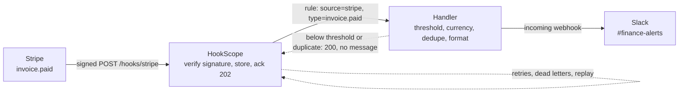
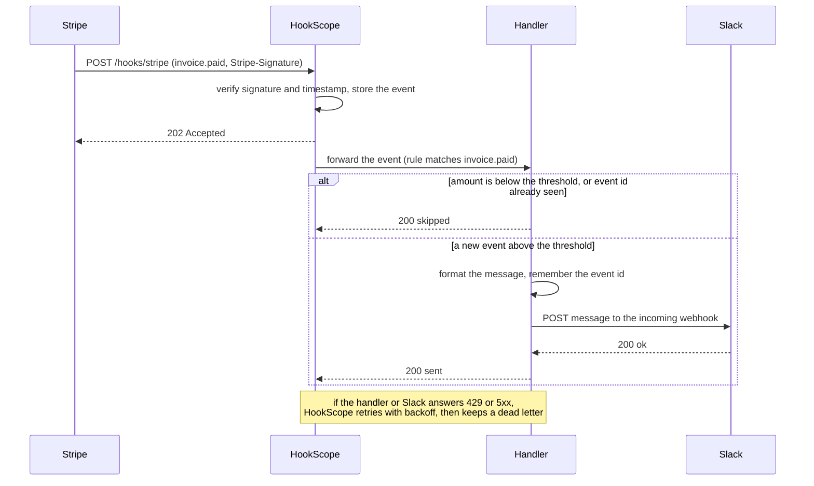

# stripe-invoice-paid-to-slack

Tell the finance team in Slack when a customer pays an invoice above a threshold, in a message a
human can act on, without drowning the channel in small invoices and without announcing the same
payment twice.

| Part | Status |
|---|---|
| 1. Problem and architecture | done |
| 2. Config | next |
| 3. Core code | to do |
| 4. Happy-path tests | to do |
| 5. Failure-mode tests | to do |
| 6. Troubleshooting | to do |
| 7. Customer pack | to do |

## 1. Problem and architecture

### The scenario

A finance team at a SaaS company wants one thing from Stripe: a Slack message in `#finance-alerts`
when a **large** invoice is paid, such as a $5,000 annual plan, so they can reconcile it and thank the
customer. Small invoices (monthly $29 plans) happen hundreds of times a day and must stay out of the
channel. Two details decide whether the alert is trusted or muted within a week:

- **The message has to be readable.** Stripe's payload is a deep JSON document; finance wants the
  invoice number, the customer, the amount in the right currency and a link to open the invoice.
- **It must fire once per payment.** Stripe documents that an endpoint can receive the same event more
  than once, and Slack gets no say in that, so the integration has to deduplicate.

### What must be true

| Requirement | Why it matters |
|---|---|
| Only verified Stripe events are acted on | Anyone can POST to a public URL; the `Stripe-Signature` header is the proof |
| An invoice below the threshold sends nothing | The point of the filter |
| The threshold is in the customer's units, per currency | Stripe amounts are integers in the smallest unit (cents), and some currencies have no minor unit, so `5000` means $50.00 for USD and ¥5,000 for JPY |
| The same event never produces two messages | Stripe may redeliver; HookScope may retry |
| A Slack outage loses nothing | Failed deliveries are retried, then kept as dead letters that can be replayed |
| A skipped invoice is not an error | The handler answers 2xx, so HookScope does not retry something that was deliberately ignored |

### Where the filter lives

HookScope forwarding rules match on the **source** and the **event type** (`invoice.paid`), not on
values inside the payload, so a rule cannot say "only above $5,000". HookScope's built-in
`format: slack` would post every paid invoice. The minimum-amount filter, the currency handling and
the deduplication therefore live in a small handler that sits between HookScope and Slack, and that
handler is the code this recipe builds (part 3). This split is deliberate and worth knowing in a
customer conversation: put routing in the receiver, and business rules in code you can test.

### Architecture



### One delivery, step by step



### The message finance sees

```text
Invoice ACME-0042 paid: 1,250.00 USD
Customer: billing@acme.example
Open invoice: https://invoice.stripe.com/i/acct_test/in_1QxAcmeInvoice
(event evt_1QxAcmePaid, test mode)
```

The invoice number, customer email, amount and link come from the `invoice` object inside the event
(`number`, `customer_email`, `amount_paid`, `currency`, `hosted_invoice_url`). The sample payload used
by the tests is built by `common/fixtures.py`: `stripe_invoice_paid()`.

### Decisions made up front

1. **Deduplicate on the Stripe event id** (`evt_...`), not on the invoice id: a second event about the
   same invoice (a later correction) is news, a redelivery of the first is not.
2. **Compare in major units per currency**, using a small table of zero-decimal currencies, so the
   threshold reads "5,000 USD", not "500000".
3. **Answer 2xx for skips**, 5xx only when Slack could not be reached, so retries are reserved for
   real failures.
4. **Slack is a mock in the tests**: the repository's `common/mocks` stands in for it, and the recipe
   says so rather than claiming it was exercised against a real workspace.

## 2. Config

_Next commit: the HookScope rules file and a `docker-compose.yml` that runs HookScope, the handler and
a mock Slack with one command._

## 3. Core code

_To do: the handler, in small typed functions._

## 4. Happy-path tests

_To do: signed `invoice.paid` fixtures through HookScope to the handler._

## 5. Failure-mode tests

_To do: duplicates, Slack 429 and 500, a below-threshold invoice, zero-decimal currencies, replay after
a Slack outage._

## 6. Troubleshooting

_To do: symptom, cause, how to check and fix, with real log lines._

## 7. Customer pack

_To do: FAQ, discovery questions and a go-live checklist._
